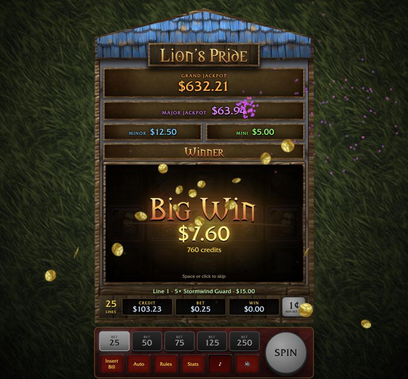

# Lion's Pride Slots

A personal, play-money slot machine themed on the Lion's Pride Inn in Goldshire (World of Warcraft). It is a fan project made for fun: no real money, not for sale.

**Not real gambling.** Every credit, bet, win and jackpot is play money. Nothing can be bought, sold, withdrawn or exchanged for anything of value.

Play it in your browser: https://andrewamisola.github.io/lions-pride-slots/



## Play

```bash
python3 tools/serve.py 4810
```

Then open http://localhost:4810. Space spins.

## What's in it

- 5 reels, 25 lines, denominations from 1¢ to 10¢, credit / bet / win meters.
- **Darkmoon Faire bonus** (hold and spin): six gold orbs lock and give 3 respins; prize tickets that land reset the count. Tickets can carry the Mini, Minor or Major; fill all 15 spots for the Grand.
- **Free games**: three portals win 10 free games with line wins tripled.
- **XP bar**: every paid spin earns experience. A level-up opens the Faire with a buff.
- **Big-win ceremony**: every credit counted one at a time, with drums, fireworks and a coin fountain.
- Reel suspense when a bonus is one symbol away.

## Files

- `index.html`: markup and styles.
- `app.js`: the interface and game flow.
- `engine.js`: symbols, pays, jackpots and bonus odds. Start here to retheme or rebalance.
- `sim.js`: `node sim.js` simulates a few million spins and prints the payout rate (currently about 96%).
- `tools/casc.py`: a read-only extractor for a local World of Warcraft install (`python3 tools/casc.py <fileDataID>=<output path>`).
- `tools/serve.py`: a small dev server that disables browser caching.

## Assets

The icons, textures, fonts, sounds and music in `assets/` come from World of Warcraft and belong to Blizzard Entertainment. They are included for personal, non-commercial use only. This project is not affiliated with or endorsed by Blizzard.

The layout follows the hold-and-spin style of casino slot machines; it is not connected to any slot machine maker.
